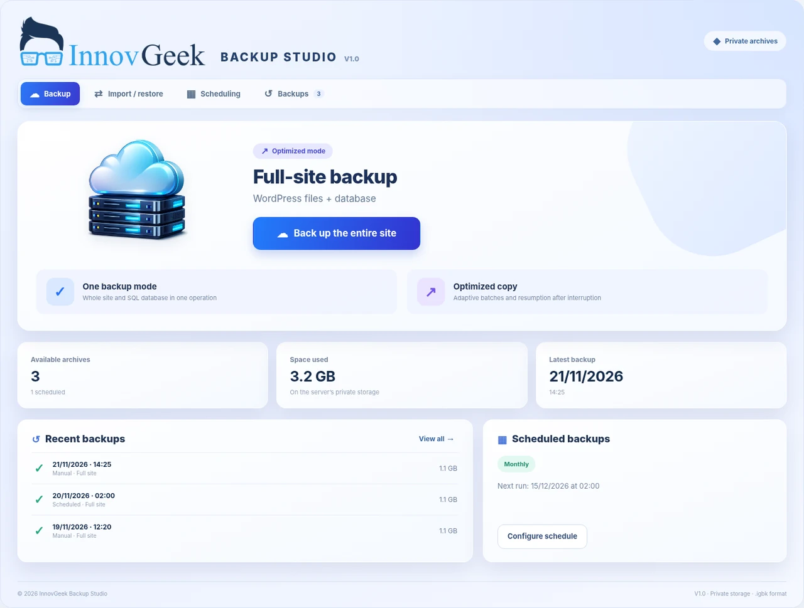
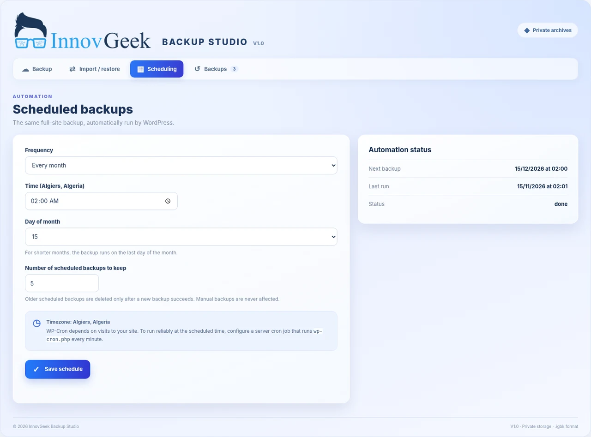
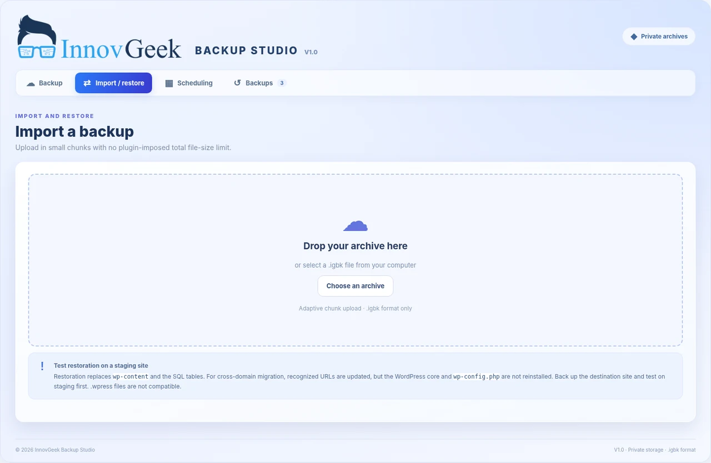
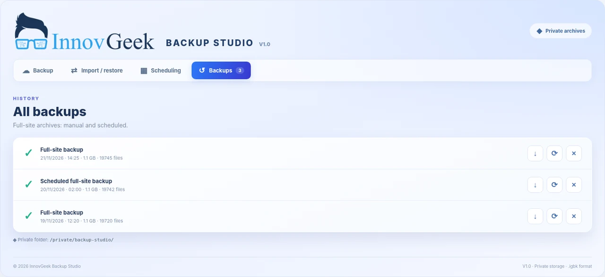
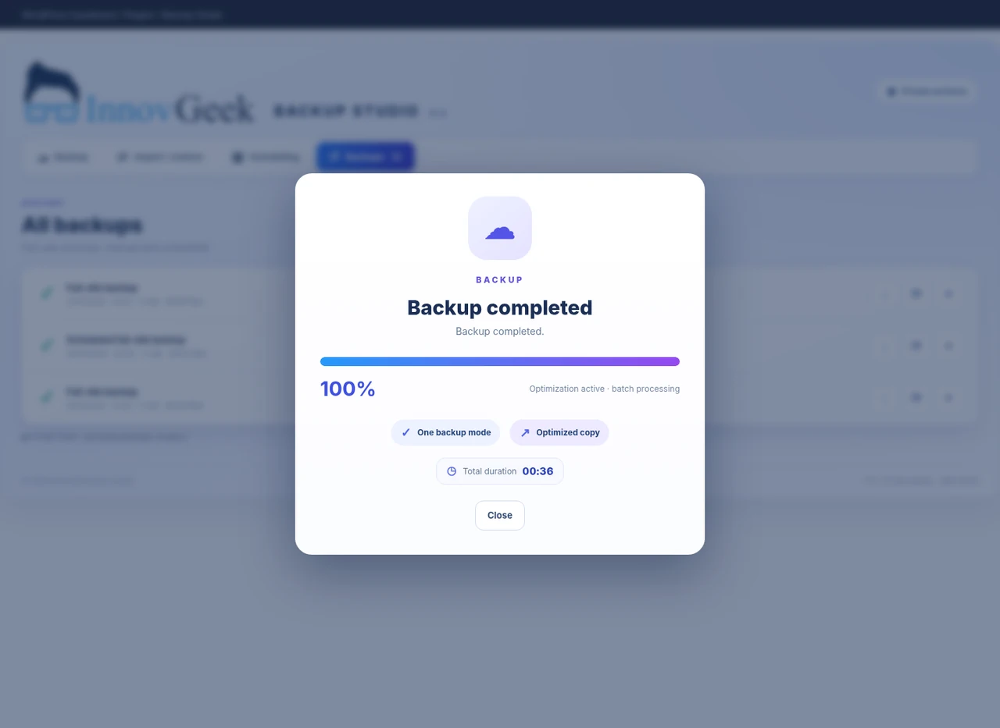

<div align="center">
  

  # BACKUP STUDIO

  **One complete WordPress backup. One clean, controlled workflow.**

  
  
  
  
  

  **🇬🇧 English** · [🇫🇷 Français](README.fr.md)

  [Overview](#overview) · [Features](#features) · [Screenshots](#screenshots) · [Installation](#installation) · [User guide](#user-guide) · [FAQ](#faq)
</div>

---

## Overview

**InnovGeek Backup Studio** is an independent WordPress plugin built around **one backup mode: the complete website**. Rather than choosing between a files-only and database-only backup, you create a native `.igbk` archive containing ordinary files beneath the WordPress root and WordPress-prefixed SQL tables.

Use its French/English admin dashboard to create and download backups, upload and verify archives, restore supported site data, schedule backups **daily, weekly, or monthly**, and manage retention. Transfers are chunked, integrity checks use **SHA-256**, and archive deletion is designed to return quickly while cleanup continues via WP-Cron.

> **About size limits:** Backup Studio does not impose an arbitrary *total archive size* ceiling. PHP, web-server, disk, hosting and database constraints still apply.



*Interface preview generated from the V1.0 HTML/CSS views using illustrative sample data.*

## Features

| Capability | Description |
|:--|:--|
| **One full-site mode** | Site files under the WordPress installation root plus SQL tables with the configured WordPress table prefix. |
| **Native `.igbk` archives** | The plugin's own format; not `.wpress`. |
| **Resumable backups** | Checkpointed processing; eligible interrupted manual jobs can be resumed. |
| **Chunked uploads** | Direct-streaming upload with a standard multipart fallback, adaptive chunks and checkpoint recovery. |
| **SHA-256 integrity checks** | Verify archive records before a restore. |
| **Guided restoration** | Explicit confirmation followed by restoration of supported `wp-content` files and database tables. |
| **Cross-domain URL adaptation** | Recognized database URLs can be updated during a site migration; manual verification is still needed. |
| **Scheduled jobs** | Daily, weekly or monthly complete backups in the Algiers timezone. |
| **Retention** | Retain 1–50 scheduled archives without automatically deleting manual backups. |
| **Fast list removal** | Deleted archives disappear from the list before WP-Cron completes their physical cleanup. |
| **Elapsed-time display** | A stopwatch shows the total backup or restore duration. |
| **Bilingual interface** | French or English based on the administrator's WordPress locale. |

## Screenshots

These are screenshots of the **actual V1.0 interface views**, rendered with fictional example archives, dates, sizes and statuses. They are not production-site screenshots.

| English dashboard | Monthly scheduling |
|:--:|:--:|
| [](docs/screenshots/dashboard-en.webp) | [](docs/screenshots/schedule-en.webp) |
| **Import / restore** | **Archive history** |
| [](docs/screenshots/import-en.webp) | [](docs/screenshots/backups-en.webp) |



*Illustrative completed-backup dialog with a stopwatch; actual duration depends on the site and its hosting.*

## Installation

### Requirements

- **WordPress 5.9+**, on a supported single-site installation.
- **PHP 7.4+** and a working MySQL/MariaDB database connection.
- Sufficient writable disk space for archives, temporary import data and restoration.
- A **private archive location outside the public web root**. Set `INNOVGEEK_BACKUP_DIR` if needed.
- Working WP-Cron; a server-side cron job is recommended when execution times matter.

### Install the plugin

1. In WordPress, go to **Plugins → Add Plugin → Upload Plugin**.
2. Select the **InnovGeek Backup Studio V1.0** ZIP archive.
3. Click **Install Now**, then **Activate**.
4. Open **Backup Studio** from the administrator menu.
5. When replacing an older version, confirm **Replace current with uploaded**, and keep the separate private backup storage directory intact.

### Package structure

```text
innovgeek-backup-studio/
├── innovgeek-backup-studio.php
├── includes/                  # PHP engine, scheduler and admin interface
├── assets/                    # CSS, JavaScript, official logo and illustration
├── languages/                 # Localization data
├── docs/
│   └── screenshots/           # README screenshots
├── README.md                  # Default English documentation
├── README.fr.md               # French documentation
├── README.en.md               # English documentation (alternate link)
└── readme.txt                 # WordPress plugin metadata
```

## User guide

### 1. Create a complete backup

1. Open **Backup** and choose **Back up the entire site**.
2. Backup Studio enumerates eligible files, exports WordPress-prefixed SQL tables and assembles the `.igbk` archive in checkpointed steps.
3. Follow the progress indicator and stopwatch; avoid closing the page unnecessarily during a manual backup.
4. After the operation reaches **100%**, close the dialog. The archive appears under **Backups**.
5. If an interrupted manual backup is recoverable, use **Resume** or discard that pending job with **Delete**.


The archive may **contain** WordPress core files and `wp-config.php` when they reside under `ABSPATH`. **Automatic restoration does not reinstall these files**; refer to [limitations](#limitations-and-security).

### 2. Upload an archive

1. Open **Import / restore**.
2. Drag a supported **`.igbk`** file into the dropzone or select **Choose an archive**.
3. The browser sends chunks to private storage. The transfer can resume from a server-confirmed checkpoint when the partial archive matches.
4. SHA-256 validation starts once upload is complete.
5. Review the restore prompt before confirming any changes to the destination.


**Important:** Backup Studio does **not** import `.wpress` files from All-in-One WP Migration. HTTP 413, 405, firewall or PHP restrictions may still require server configuration changes.

### 3. Restore safely

1. From **Backups**, select verify/restore for the desired archive, or finish importing a new `.igbk` file.
2. Review the warning: destination files and supported SQL tables will be replaced.
3. Enter the confirmation keyword **`RESTAURER`** exactly — the keyword is intentionally unchanged in English.
4. Allow the restore to complete, then log in again if WordPress requests it.
5. Test pages, media, links, forms, plugins and administrator access.

**Automatic restoration covers supported `wp-content` files and SQL tables, but does not reinstall WordPress core or `wp-config.php`.** Recognized database URLs can be adapted for a different domain, but plugin-specific and external configurations still require review.

> **Before restoring to a live site:** take an *independent* backup of the destination and test the archive on staging. Restoration changes destination data.

### 4. Schedule complete backups

Use **Scheduling** to set a frequency, execution time, and the number of scheduled archives to keep. The timezone is fixed to **Algiers, Algeria — `Africa/Algiers` (UTC+01:00)**.

| Frequency | Behavior |
|---|---|
| **Disabled** | No automatic backups. |
| **Daily** | One complete backup each day at the configured time. |
| **Weekly** | One complete backup on the chosen weekday and time. |
| **Monthly** | One complete backup on calendar day 1–31 and the chosen time. Missing days are clamped to the last day of shorter months. |


Retention is **1–50 scheduled backups** and is applied only after a successful new scheduled backup. **Manual backups are excluded from automatic retention.**

WP-Cron may run late on sites with no traffic. Configure an appropriate server cron trigger for more predictable execution times.

### 5. Manage archives

The **Backups** screen provides archive date, size, file count and actions to **download**, **verify/restore** or **delete**.


Deletion is **logically fast**: the list is updated promptly, while WordPress physically deletes files later via WP-Cron. Disk space is not necessarily released immediately.

## Languages

To switch between **English and French**, go to **Users → Profile → Language** in WordPress, select the administrator language, and refresh **Backup Studio**. This does not change backup files or scheduling settings.

- [English documentation (default)](README.md)
- [Documentation française](README.fr.md)

## Limitations and security

- WordPress **multisite** and a **custom `wp-content` location** are not supported by this edition.
- Files outside `ABSPATH`, symbolic links and SQL tables without the WordPress prefix are not automatically included. Certain cache and temporary files are excluded.
- The native format **`.igbk`** is not compatible with **`.wpress`**.
- Automatic restore does **not** reinstall **WordPress core** or **`wp-config.php`**. Prepare the target installation first.
- Cross-domain URL handling covers recognized data patterns only. Review plugin-specific settings, external integrations and site links after migration.
- No imposed total archive size is **not** a promise of unlimited performance or capacity; hosting and storage restrictions still apply.
- Private archive storage should remain **outside the web root** with suitable file-system permissions.
- Scheduling and asynchronous physical deletion depend on **WP-Cron** being operational.

### Example timing measurements

On one user-tested WordPress installation of approximately **1 GB**, a backup took **00:36** and a restore took **01:38**. These are specific observations, **not performance guarantees** for other installations.

## FAQ

<details>
<summary><strong>Are backup archives truly unlimited in size?</strong></summary>

Backup Studio does not enforce a fixed total archive size ceiling, but available disk capacity, hosting policies, PHP and server constraints still apply.
</details>

<details>
<summary><strong>Can I import `.wpress` files?</strong></summary>

No. Only native `.igbk` archives generated by Backup Studio are supported.
</details>

<details>
<summary><strong>Can I restore an archive to an entirely empty server?</strong></summary>

Not directly. Install and prepare WordPress first: core WordPress files and `wp-config.php` are not restored automatically.
</details>

<details>
<summary><strong>Why did a scheduled backup start later than expected?</strong></summary>

WP-Cron is traffic-dependent unless a system-level cron trigger is configured.
</details>

<details>
<summary><strong>Why is deleted archive space still in use?</strong></summary>

The archive is removed from the list first; WP-Cron finishes physical cleanup afterward.
</details>

## License and credits

- **Developed by:** InnovGeek.
- **Version:** 1.0.
- **License declared by the plugin:** GPL-2.0-or-later.
- **Screenshots:** rendered V1.0 HTML/CSS views with fictional sample data; not screenshots of a production WordPress site.

---

<div align="center">
  <strong>InnovGeek Backup Studio</strong><br />
  One complete backup. One clear interface. Full control of your archives.
</div>
