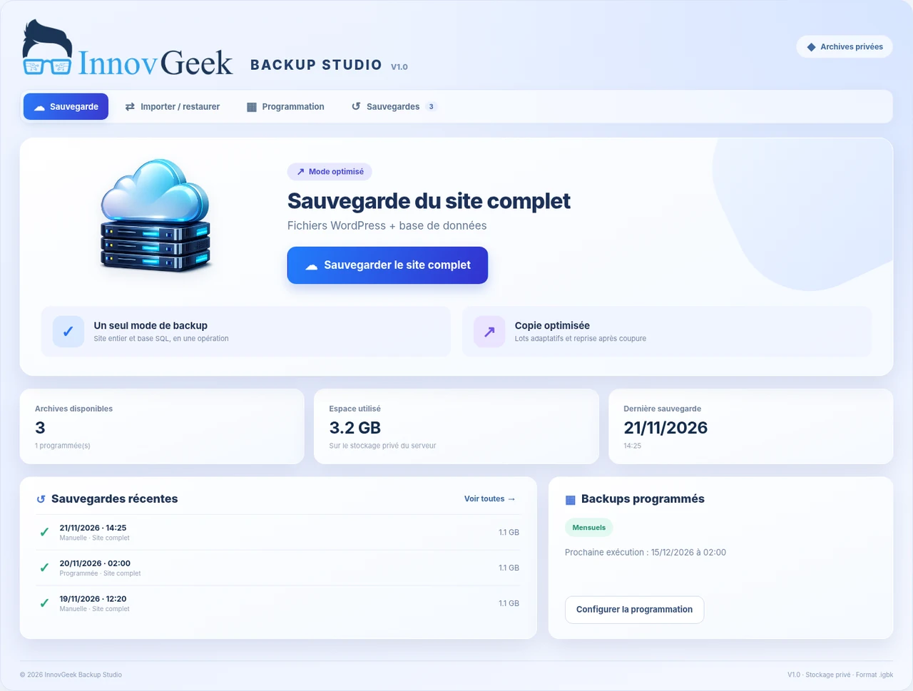
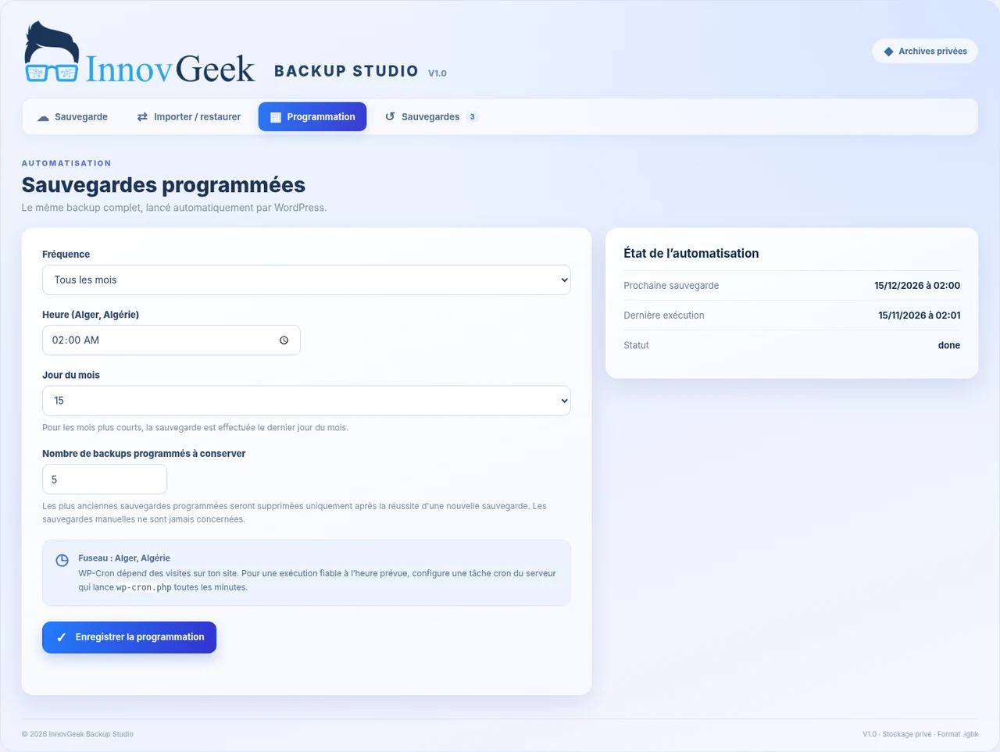
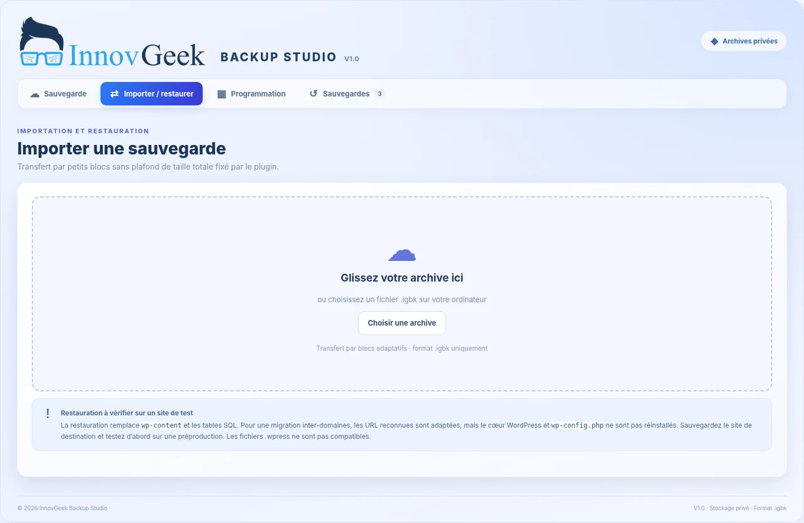
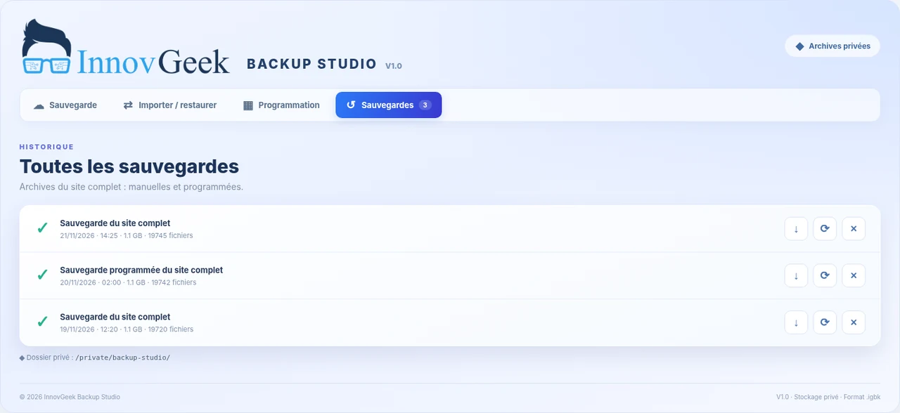
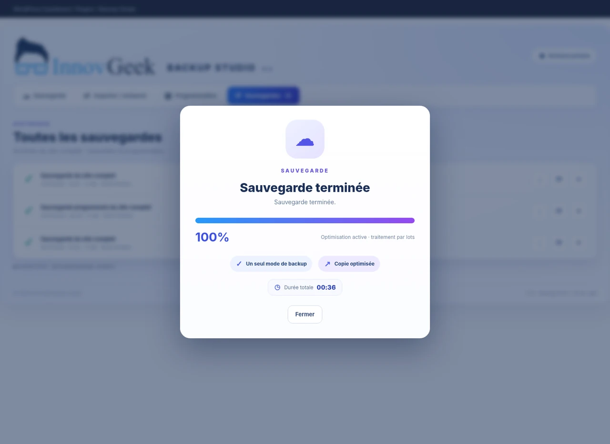
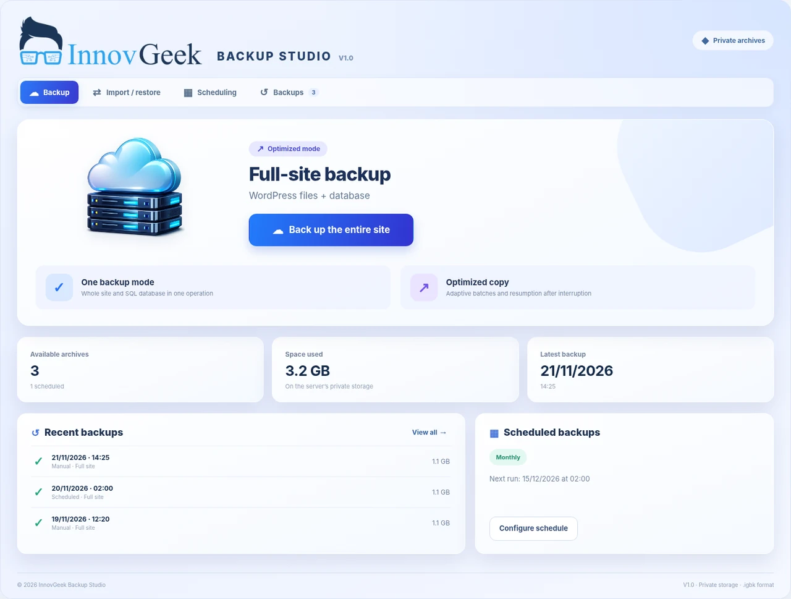

<div align="center">
  

  # BACKUP STUDIO

  **La sauvegarde WordPress complète, simple et maîtrisée.**  
  *Full-site WordPress backups, built for control and simplicity.*

  
  
  
  
  

  [🇬🇧 English (default)](README.md) · **🇫🇷 Français**

  [Présentation](#presentation) · [Fonctionnalités](#fonctionnalites) · [Captures](#captures-decran) · [Installation](#installation) · [Guide d'utilisation](#guide-dutilisation) · [FAQ](#faq)
</div>

---

## Presentation

**InnovGeek Backup Studio** est une extension WordPress indépendante consacrée à un objectif : **créer, importer et restaurer des sauvegardes complètes de votre site**, depuis un tableau de bord épuré. Pas de modes « fichiers seuls » ou « base seule » à choisir : une sauvegarde couvre les fichiers du site accessibles sous la racine WordPress et les tables de base de données correspondant au préfixe WordPress.

L'extension possède une interface **française / anglaise**, des sauvegardes automatiques **quotidiennes, hebdomadaires ou mensuelles**, un transfert d'archives par blocs, une vérification **SHA-256** et une suppression rapide avec nettoyage différé.

> **Taille des sauvegardes :** aucun plafond *total* n'est imposé par le plugin. Les limites de PHP, du serveur HTTP, du stockage, du système de fichiers et de l'hébergement s'appliquent toujours.



*Capture de l'interface V1.0, réalisée à partir des vues du plugin avec des données de démonstration.*

## Fonctionnalites

| Fonctionnalité | Description |
|:--|:--|
| **Un seul mode : site complet** | Fichiers de l'installation WordPress et tables SQL préfixées, dans une seule archive. |
| **Archives `.igbk`** | Format natif indépendant des fichiers `.wpress`. |
| **Sauvegarde avec reprise** | Traitement par étapes et reprise des tâches manuelles interrompues quand leur état est récupérable. |
| **Importation par blocs** | Transfert direct avec solution de repli classique, réduction des blocs si nécessaire et reprise des données reçues. |
| **Contrôle SHA-256** | Vérification de l'intégrité des enregistrements avant restauration. |
| **Restauration guidée** | Vérification de l'archive, confirmation explicite, restauration de `wp-content` et des tables SQL compatibles. |
| **Migration inter-domaines** | Adaptation d'URL reconnues dans les données SQL ; vérification des plugins et des liens requise ensuite. |
| **Programmation** | Sauvegardes chaque jour, chaque semaine ou chaque mois à l'heure choisie. |
| **Rétention automatique** | Conservation de 1 à 50 sauvegardes **programmées** ; les sauvegardes manuelles ne sont pas purgées par cette règle. |
| **Suppression rapide** | Retrait immédiat de la liste puis nettoyage physique asynchrone par WP-Cron. |
| **Chronomètre** | Temps total affiché à la fin des sauvegardes et restaurations. |
| **Interface bilingue** | Français ou anglais suivant la langue de l'administration WordPress. |

## Captures d'ecran

Les captures ci-dessous illustrent les **écrans réels du plugin**. Les archives, dates, volumes et statuts affichés ont été renseignés à des fins de démonstration ; ils ne proviennent pas d'un site client.

| Tableau de bord | Sauvegardes programmées |
|:--:|:--:|
| [](docs/screenshots/dashboard-fr.webp) | [](docs/screenshots/schedule-fr.webp) |
| **Importation / restauration** | **Historique des archives** |
| [](docs/screenshots/import-fr.webp) | [](docs/screenshots/backups-fr.webp) |

**Fenêtre de progression et chronomètre**



*Exemple visuel de fin d'opération. Les durées varient selon la taille du site et l'hébergement.*

## Installation

### Prérequis

- **WordPress 5.9+**, installation classique mono-site ; **PHP 7.4+**.
- Base de données MySQL ou MariaDB opérationnelle et droits d'accès suffisants.
- Espace disque disponible pour créer ou importer les archives.
- Un dossier **privé et accessible en écriture**, situé **hors de la racine Web** (configurable avec `INNOVGEEK_BACKUP_DIR` si nécessaire).
- WP-Cron fonctionnel ; pour un horaire précis, une tâche cron serveur est recommandée.

### Installation depuis WordPress

1. Ouvrir **Extensions → Ajouter une extension → Téléverser une extension**.
2. Sélectionner le fichier ZIP de **InnovGeek Backup Studio V1.0**.
3. Cliquer sur **Installer**, puis **Activer**.
4. Ouvrir **Backup Studio** dans le menu de l'administration.
5. Si une version antérieure est déjà installée, utiliser l'option **Remplacer l'extension actuelle**. Ne pas effacer le dossier privé des archives.

### Structure des dossiers

```text
innovgeek-backup-studio/
├── innovgeek-backup-studio.php
├── includes/                  # Moteurs PHP, interface et programmation
├── assets/                    # Feuilles de style, JavaScript, logo et illustration
├── languages/                 # Ressources de localisation
├── docs/
│   └── screenshots/           # Captures utilisées dans les README
├── README.md                  # Documentation anglaise par défaut
├── README.fr.md               # Documentation française
├── README.en.md               # English documentation
└── readme.txt                 # Métadonnées WordPress
```

## Guide d'utilisation

### 1. Sauvegarder le site complet

1. Dans **Sauvegarde**, cliquer sur **Sauvegarder le site complet**.
2. Le plugin inventorie les fichiers, exporte les tables SQL concernées puis construit l'archive `.igbk` par étapes.
3. Suivre la progression et le **chronomètre**. Ne pas interrompre inutilement le navigateur pendant une sauvegarde manuelle.
4. Lorsque la tâche affiche **100 %**, fermer la fenêtre : l'archive apparaît dans **Sauvegardes**.
5. Au besoin, utiliser **Reprendre** pour continuer une tâche manuelle récupérable, ou **Supprimer** pour l'écarter.


**Périmètre :** l'archive peut contenir le cœur de WordPress et `wp-config.php` s'ils se trouvent sous `ABSPATH` ; cela **n'implique pas** que la restauration automatique réinstalle ces fichiers. Voir les [limites](#limites-et-securite).

### 2. Importer une archive

1. Ouvrir **Importer / restaurer**.
2. Glisser une archive **`.igbk`** dans la zone dédiée ou utiliser **Choisir une archive**.
3. Laisser les blocs être transférés vers le stockage privé. Le transfert peut reprendre à une position déjà enregistrée si le fichier partiel correspond.
4. La validation SHA-256 démarre une fois l'importation terminée.
5. Après validation, confirmer ou abandonner la restauration proposée.


**À savoir :** le plugin ne lit **pas** les archives `.wpress` d'All-in-One WP Migration. Un refus HTTP 413, 405 ou une limite PHP peut exiger un ajustement de l'hébergement, malgré le transfert par blocs.

### 3. Restaurer avec précaution

1. Depuis **Sauvegardes**, cliquer sur l'action de vérification/restauration, ou terminer l'importation d'une archive.
2. Lire l'avertissement de remplacement des fichiers et des tables SQL.
3. Entrer le mot de confirmation exact **`RESTAURER`**.
4. Attendre **Restauration terminée**, puis se reconnecter à WordPress si nécessaire.
5. Vérifier le site : pages, images, liens, extensions, formulaires et accès à l'administration.

**La restauration automatique couvre `wp-content` et les tables SQL prises en charge, mais ne réinstalle pas le cœur WordPress ni `wp-config.php`.** Elle peut adapter les URL reconnues lors d'un changement de domaine, sans garantir la correction de toutes les données particulières aux extensions.

> **Avant toute restauration réelle :** conserver une sauvegarde *indépendante* du site de destination et effectuer un essai sur une **préproduction**. La restauration modifie durablement les données du site cible.

### 4. Programmer les sauvegardes

Dans **Programmation**, choisir la fréquence, l'heure en **Alger, Algérie (`Africa/Algiers`, UTC+01:00)** et le nombre d'archives programmées à conserver.

| Fréquence | Comportement |
|---|---|
| **Désactivée** | Aucune sauvegarde automatique. |
| **Tous les jours** | Une sauvegarde quotidienne à l'heure configurée. |
| **Toutes les semaines** | Une sauvegarde au jour de la semaine et à l'heure choisis. |
| **Tous les mois** | Une sauvegarde au jour du mois (1–31) et à l'heure choisis. Si ce jour n'existe pas, utilise le dernier jour du mois. |


La **rétention de 1 à 50** ne concerne que les sauvegardes automatiques et s'applique après la réussite d'une nouvelle sauvegarde programmée. Les archives manuelles sont conservées jusqu'à une suppression volontaire.

**Attention à WP-Cron :** WordPress peut différer une exécution si le site ne reçoit aucune visite. Pour lancer les tâches à des heures précises, configurer un cron système sur l'hébergement ; le plugin continuera d'utiliser ses points de reprise.

### 5. Gérer et supprimer les archives

Dans **Sauvegardes**, retrouver la date, la taille et le nombre de fichiers, puis **télécharger**, **vérifier/restaurer** ou **supprimer** une archive.


La suppression retire rapidement le fichier de la liste, mais **l'espace disque n'est libéré qu'après le nettoyage différé par WP-Cron**. Éviter de supprimer manuellement les dossiers internes pendant une tâche active.

## Langues

L'interface existe en **français et anglais**. Dans l'administration WordPress, ouvrir **Utilisateurs → Profil → Langue**, sélectionner la langue puis actualiser Backup Studio. Le changement de langue ne modifie ni le contenu des sauvegardes ni les réglages de programmation.



## Limites et securite

- **Pas de multisite** et pas de dossier `wp-content` personnalisé pris en charge par cette édition.
- Les fichiers **hors de `ABSPATH`**, les liens symboliques et les tables sans préfixe WordPress ne sont pas couverts automatiquement ; certains caches et fichiers temporaires sont exclus.
- Le format natif **`.igbk`** n'est pas compatible avec **`.wpress`**.
- La restauration automatique ne réinstalle **ni WordPress core ni `wp-config.php`** : préparer le site de destination au préalable.
- La migration entre domaines actualise des URL reconnues dans la base, mais un contrôle manuel demeure indispensable (liens, données sérialisées particulières, plugins et configurations externes).
- La capacité à sauvegarder des sites volumineux dépend toujours du **disque, de PHP, du serveur Web et de la base SQL**. « Sans limite » signifie uniquement **sans limite totale arbitraire définie par le plugin**.
- Les archives sont stockées dans un dossier privé **hors racine Web** ; vérifier les permissions système et vos politiques de sauvegarde externe.
- La suppression physique différée et la programmation nécessitent un **WP-Cron fonctionnel**.

### Mesures indicatives

Lors d'un essai utilisateur sur un site d'environ **1 Go**, une sauvegarde a été mesurée à **00:36**, et une restauration à **01:38**. Ces durées sont **des observations ponctuelles**, pas des garanties de performance pour d'autres hébergements.

## FAQ

<details>
<summary><strong>La taille des sauvegardes est-elle vraiment illimitée ?</strong></summary>

L'extension n'applique pas de plafond total fixe à une archive `.igbk`, mais l'espace disque, les règles PHP et les limitations du serveur restent déterminants.
</details>

<details>
<summary><strong>Puis-je importer une sauvegarde `.wpress` ?</strong></summary>

Non. Seuls les fichiers `.igbk` générés par Backup Studio sont compatibles.
</details>

<details>
<summary><strong>Une restauration suffit-elle à reconstruire un WordPress entièrement vide ?</strong></summary>

Pas automatiquement : la restauration remet en place les fichiers compatibles de `wp-content` et les tables SQL, mais pas le cœur WordPress ni `wp-config.php`. Installer et préparer WordPress au préalable.
</details>

<details>
<summary><strong>Pourquoi une tâche programmée ne démarre-t-elle pas à l'heure exacte ?</strong></summary>

WP-Cron dépend de l'activité du site. Une tâche cron au niveau du serveur améliore la ponctualité des déclenchements.
</details>

<details>
<summary><strong>Pourquoi l'espace disque ne baisse-t-il pas immédiatement après suppression ?</strong></summary>

Les archives sont retirées de la liste, puis leur fichier physique est nettoyé plus tard par WP-Cron.
</details>

## Licence et credits

- **Développement :** InnovGeek.
- **Version :** 1.0.
- **Licence déclarée par l'extension :** GPL-2.0-or-later.
- **Captures :** rendus des vues HTML/CSS de la version V1.0, avec données fictives de démonstration ; ce ne sont pas des captures d'un hébergement de production.

---

<div align="center">
  <strong>InnovGeek Backup Studio</strong><br />
  Une sauvegarde complète. Une interface claire. Le contrôle de vos archives.
</div>
